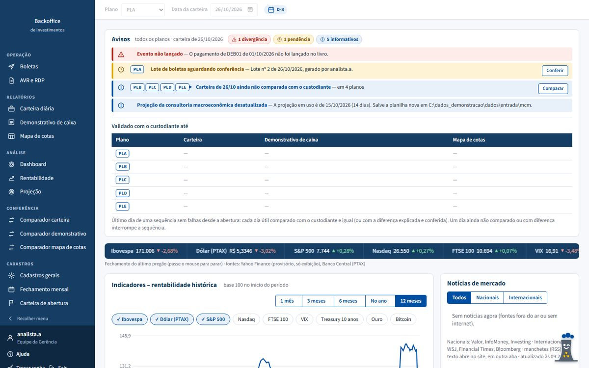
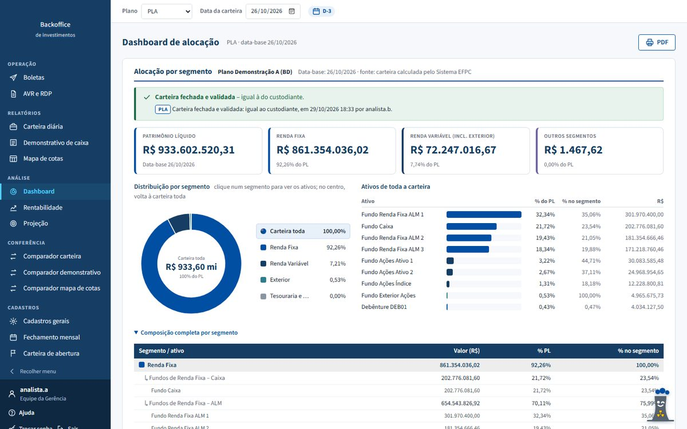
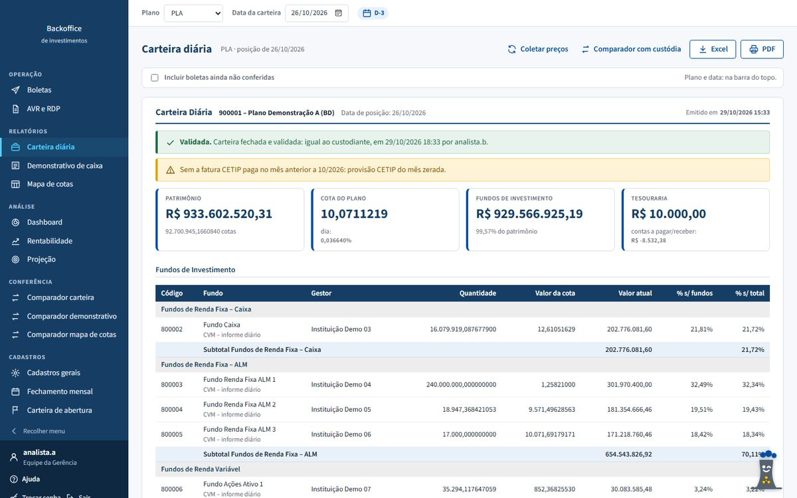
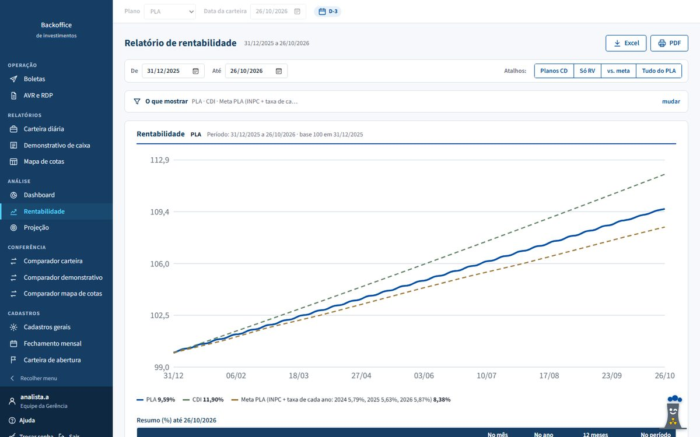
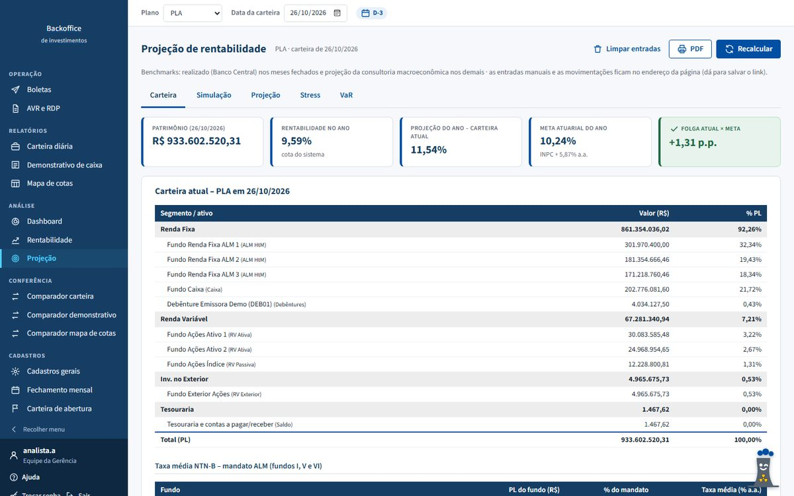
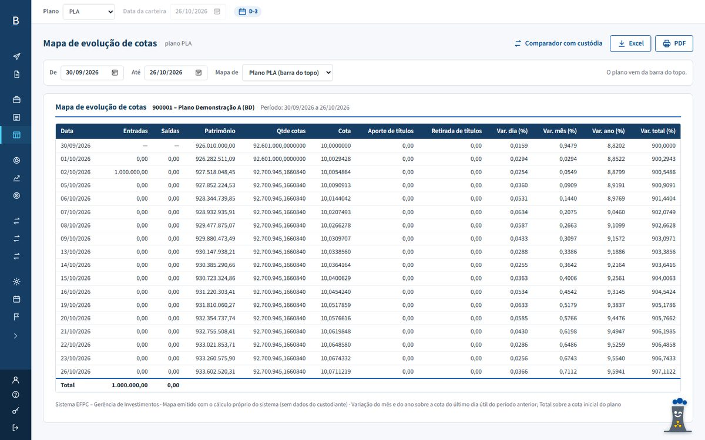
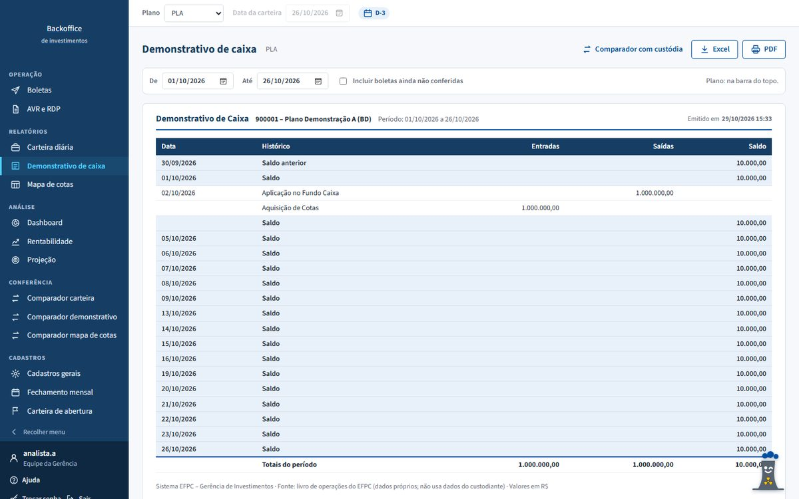
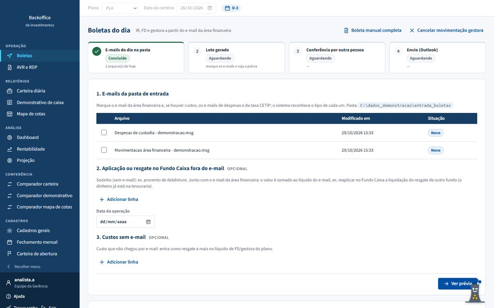
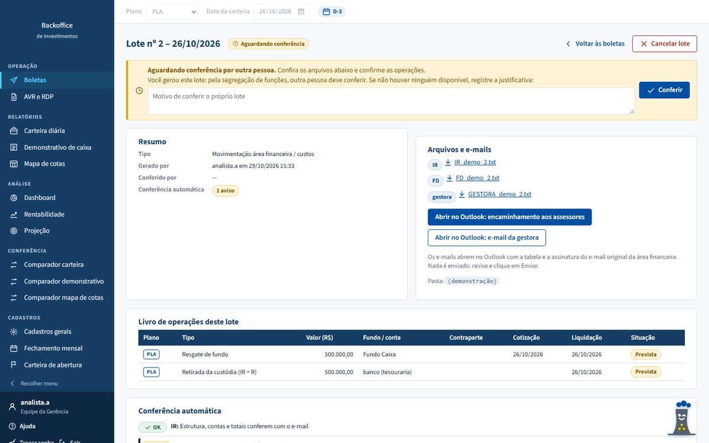
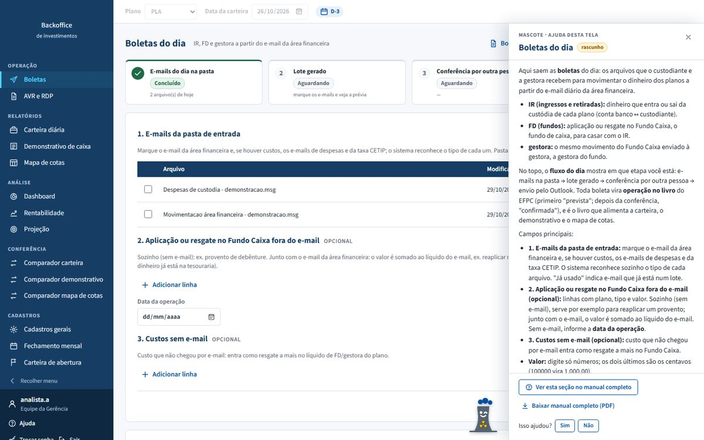

# Backoffice de Investimentos para EFPC

Sistema web de **backoffice de investimentos** para uma Entidade Fechada de Previdência Complementar (EFPC, fundo de
pensão) com vários planos de benefícios. Calcula a carteira de cada plano todos os dias **com dados próprios**, confere
o custodiante, gera as boletas do dia e entrega à equipe dashboards, rentabilidade e projeções.

> As telas abaixo usam uma **base de demonstração com dados fictícios** (planos, fundos, valores e pessoas inventados).
> O código-fonte fica em um repositório privado: acesso sob solicitação.



---

## O problema
A carteira oficial dos planos vinha de um sistema terceirizado alimentado pelo próprio custodiante. Na prática, quem
deveria ser conferido era a fonte dos números. As rotinas do dia a dia (boletas, conciliações, lançamentos no sistema
financeiro, projeções) dependiam de planilhas e de scripts soltos, sem trilha de auditoria.

## A solução
- **Independência do custodiante:** a carteira é calculada a partir do livro de operações da própria EFPC e de preços de
  fontes públicas (cotas da CVM, preços da ANBIMA, índices do Banco Central). O custodiante entra **só como o lado
  conferido**.
- **Conferência contínua:** carteira, demonstrativo de caixa e mapa de cotas são comparados dia a dia com os arquivos do
  custodiante. A tela inicial mostra **até que data cada documento está validado**, e cada diferença precisa ser
  explicada e conferida por outra pessoa.
- **Operação do dia a dia:** geração e conferência das boletas a partir do e-mail da área financeira, guia de lançamentos
  para o sistema financeiro (AVR/RDP) e conferência automática dos PDFs lançados.

---

## Telas

| | |
|---|---|
|  **Dashboard de alocação** – PL por segmento e por ativo, com % do PL e % no segmento. |  **Carteira diária** – calculada pelo sistema, com a fonte de cada preço e o selo de validação. |
|  **Rentabilidade** – plano contra CDI e meta atuarial, por período e por segmento. |  **Projeção do ano** – cenários, simulação de movimentações, stress e VaR. |
|  **Mapa de cotas** – evolução diária da cota, patrimônio e fluxos. |  **Demonstrativo de caixa** – extrato da tesouraria montado só com o livro. |
|  **Boletas do dia** – fluxo em etapas, do e-mail ao envio. |  **Lote** – conferência automática e por outra pessoa (segregação de funções). |


**Ajuda integrada:** cada tela tem um painel de ajuda (com um mascote) e o manual completo sai em PDF. Testes automáticos
obrigam o manual a ser atualizado sempre que uma tela muda.

---

## Destaques técnicos
- **Números exatos:** valores e quantidades em `Decimal`, gravados como texto no banco (`DecimalTexto`), sem perda de
  precisão em quantidades com até 19 dígitos.
- **Motor de carteira diário:** parte da carteira de abertura e aplica as operações na data de cotização e de liquidação de
  cada fundo (D+0 a D+5), com regra de prioridade entre fontes de preço.
- **Cota do plano:** cota do dia = PL antes dos fluxos ÷ quantidade de cotas do dia anterior; ingressos e retiradas
  convertidos pela cota do dia.
- **Conciliação:** leitores dos arquivos do custodiante (XML ANBID e planilhas), pareamento de lançamentos e tolerância
  configurável; validação "em sequência desde a abertura".
- **Leitura de PDFs:** extração dos campos dos documentos do sistema financeiro, com tratamento de valores impressos
  cortados e conferência pelo CNPJ.
- **Segurança e controles:** roda 100% na rede local, lista fechada de fontes externas (verificada por teste),
  segregação de funções (quem gera não confere), perfis de acesso e trilha de auditoria de todos os cadastros.
- **Qualidade:** mais de 170 testes automatizados (`pytest`), incluindo testes das regras do projeto (dependências
  declaradas, URLs permitidas e independência do custodiante).

## Tecnologias
`Python 3.13` · `Django 5.2` · `SQLite (WAL)` · `Waitress` · `pandas` · `openpyxl` · `xlrd` · `pdfplumber` ·
`django-simple-history` · `pytest` · `HTML/CSS/JavaScript` (sem bibliotecas externas no navegador)

## Arquitetura (resumo)
```
apps/
  cadastro/     planos, fundos, benchmarks, calendário, parâmetros
  mercado/      coleta de cotas (CVM), preços (ANBIMA) e índices (Banco Central)
  livro/        livro de operações, abertura, demonstrativo de caixa, despesas
  operacoes/    boletas do dia (geração, conferência, e-mails)
  avr_rdp/      guia de lançamentos e conferência dos PDFs do sistema financeiro
  carteira/     motor diário, carteira, mapa de cotas, rentabilidade, validações
  custodiante/  leitura dos arquivos do custodiante e comparadores
  dashboard/    alocação e indicadores
  projecao/     projeção do ano, stress e VaR
  ajuda/        painel de ajuda, manual em PDF e capturas com dados fictícios
```

---

Desenvolvido por **Ricardo Carrera** · [LinkedIn](https://www.linkedin.com/in/ricardo-carrera-81073414b/)
